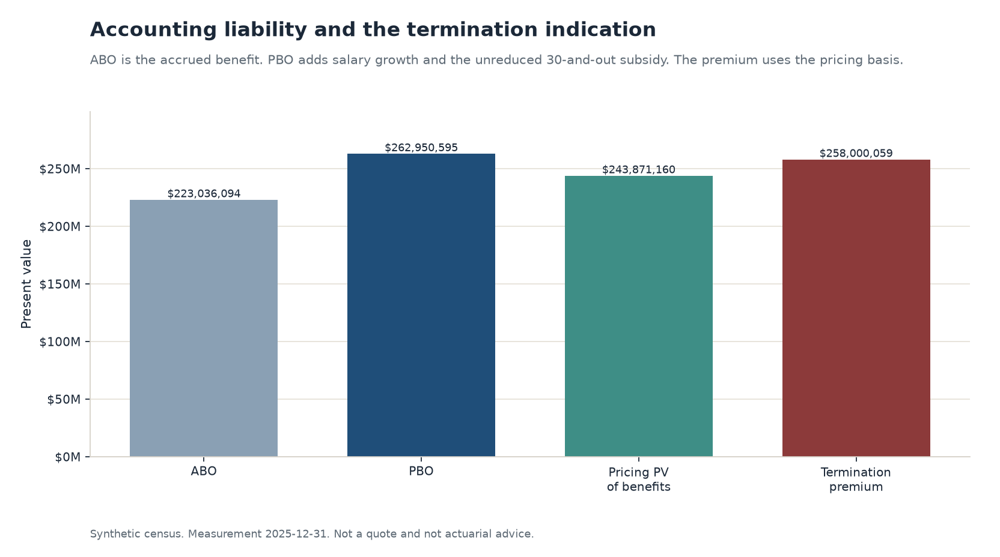
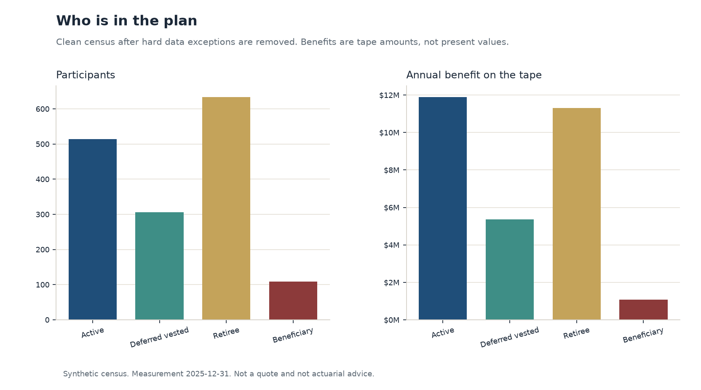
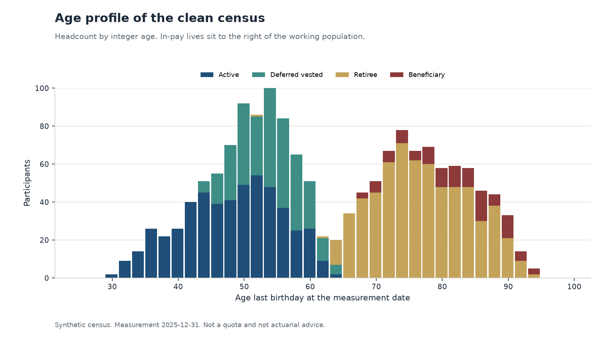
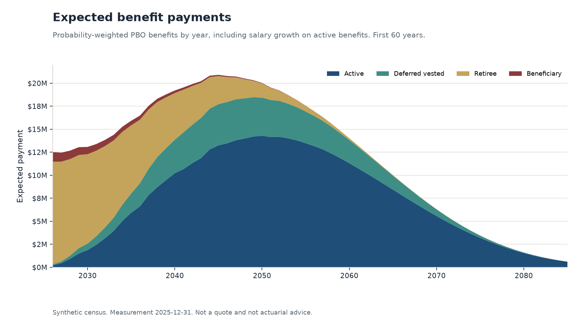
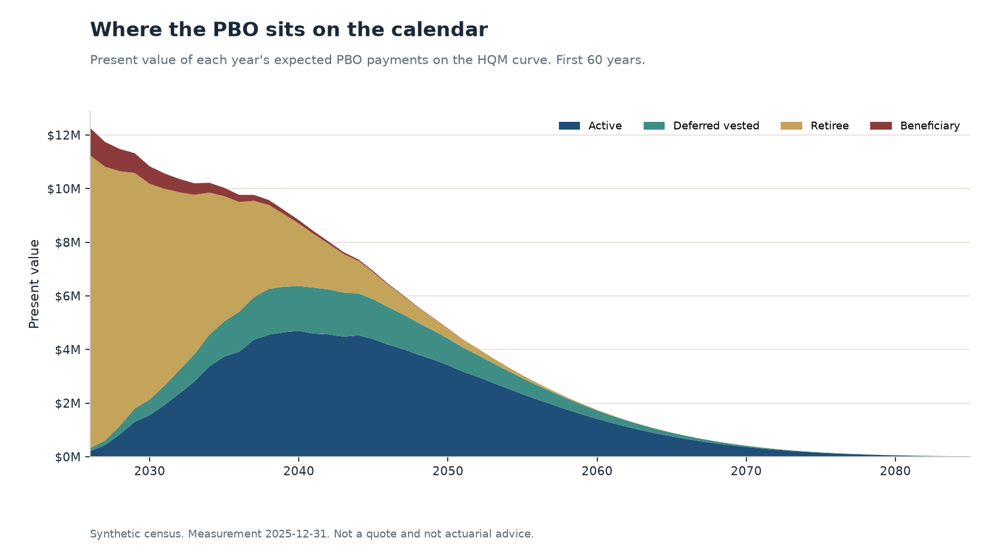
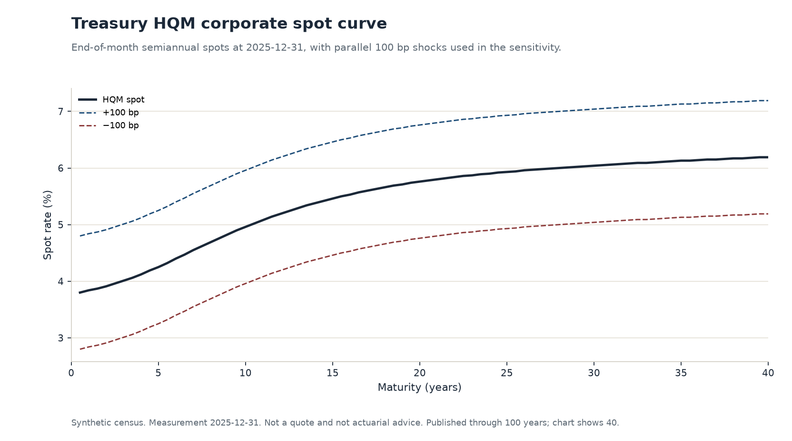
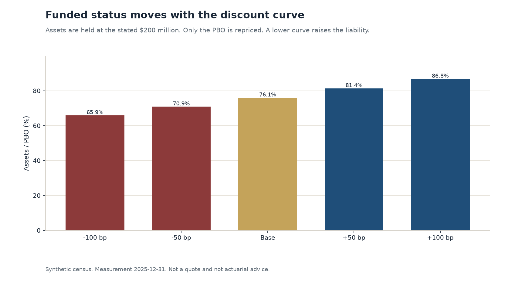
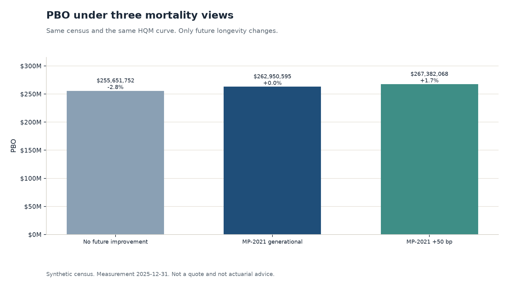
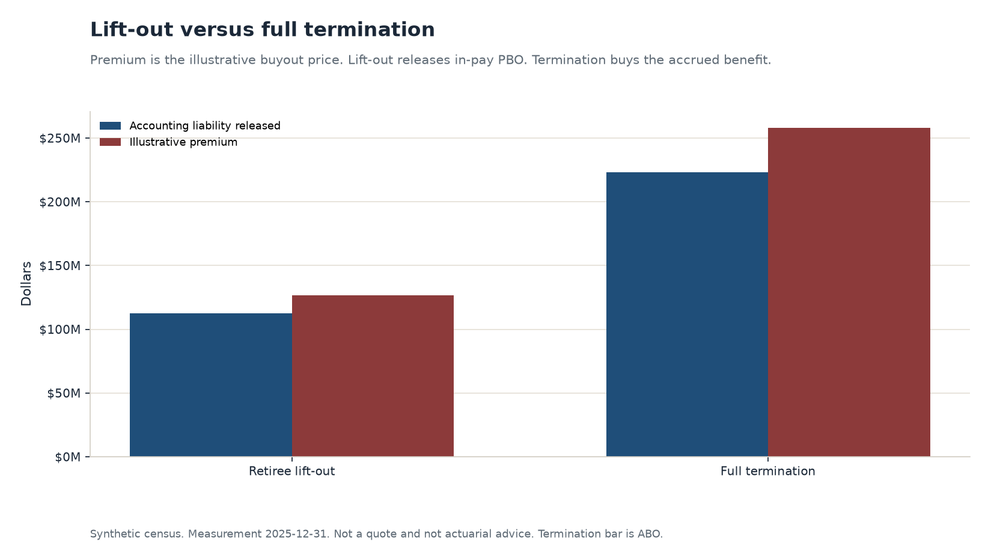

# Defined-benefit pension analysis

Seriatim valuation of a synthetic final-average-pay pension plan, and an illustrative pension risk transfer comparison: retiree lift-out versus full termination.

**Measurement date: December 31, 2025.** The census is synthetic. The mortality tables and the yield curve are public. The dollars below are the output of `python -m pension`, stored in [`reports/summary.json`](reports/summary.json). They are not a target and they were not adjusted after the model ran.

> This repository is a portfolio project by Tanner Allred, a data analyst who works on pension risk transfer. It uses a fictional plan, Northwind Components. It does not use data, pricing, or experience from Group 1001, American National, or any other insurer or plan sponsor. It is not actuarial advice and it is not a buyout quote.

## The business question

A sponsor of an ongoing defined-benefit plan can keep paying retirees, transfer the in-pay promises to an insurer (a lift-out), or terminate the plan and buy annuities for everyone. Before any of those conversations becomes a quote, someone has to answer four questions from the census tape:

1. Are the records good enough to price?
2. What is the accounting liability, split between what is already accrued and what still depends on future pay?
3. How does funded status move when interest rates move?
4. What does each transaction do to the premium, the accounting liability, and the cash the sponsor has to contribute?

That is the workflow this project runs, on one hypothetical plan.

## The result, at December 31, 2025

| | |
| --- | ---: |
| Clean participants | 1,563 of 1,580 on the tape |
| Accumulated benefit obligation (ABO) | $223,036,093.95 |
| Projected benefit obligation (PBO) | $262,950,594.69 |
| PBO minus ABO | $39,914,500.74 |
| Stated market value of assets | $200,000,000.00 |
| Deficit on the PBO | $62,950,594.69 |
| Funded ratio (assets / PBO) | 76.06% |
| Single effective discount rate | 5.70% |
| Effective duration | 13.89 years |
| DV01 (liability increase per 1 bp decline) | $361,758.55 |

The asset value was set at a round $200 million in [`src/pension/assumptions.py`](src/pension/assumptions.py) before any present value was calculated. The 76.06% funded ratio is whatever that assumption produced. It was not solved for.

The $39.9 million gap between PBO and ABO is future pay growth at 3.5% plus the unreduced “30 years and out at 62” subsidy. Retirees and beneficiaries are already in pay, so their ABO and PBO are the same number.



### Who is in the plan

| Status | Lives | Average age | Tape annual benefit | ABO | PBO |
| --- | ---: | ---: | ---: | ---: | ---: |
| Active | 514 | 47.53 | $11,896,084.55 | $74,169,472.74 | $114,083,973.48 |
| Deferred vested | 306 | 53.33 | $5,358,725.70 | $36,341,557.79 | $36,341,557.79 |
| Retiree | 634 | 76.63 | $11,306,704.86 | $104,713,663.51 | $104,713,663.51 |
| Beneficiary | 109 | 81.36 | $1,081,493.04 | $7,811,399.91 | $7,811,399.91 |
| **Total** | **1,563** | | **$29,643,008.15** | **$223,036,093.95** | **$262,950,594.69** |

Active tape benefits are the age-65 life annuity earned so far. The ABO annual amount is lower ($10.7 million versus $11.9 million on the tape) because participants who are assumed to retire at 62 under the 30-and-out rule, but who do not yet have 30 years, take a 5% per year early-retirement reduction on the ABO. The PBO restores that subsidy once future service unlocks it, and it grows final average pay.





### Where the cash flows are

Near-term payments are mostly retirees. The hump in the 2040s and 2050s is today’s actives and deferred vested participants reaching retirement, with active benefits grown at the salary scale. Discounting pulls that hump forward: more of the present value sits in the first fifteen years than the undiscounted payment chart suggests. That is why the effective duration is 13.89 years and the present-value-weighted average payment time is 14.14 years.





## Interest rates

The discount curve is the U.S. Treasury High Quality Market (HQM) corporate spot curve at the December 31, 2025 month-end. Spots are semiannually compounded, which is the Treasury convention. Selected nodes:

| Maturity | Spot |
| ---: | ---: |
| 6 months | 3.80% |
| 5 years | 4.25% |
| 10 years | 4.96% |
| 20 years | 5.76% |
| 30 years | 6.04% |

The single effective rate, 5.70%, is the annual-effective yield that reproduces the curve present value of these expected payments. It is a disclosure summary. The valuation itself discounts every month on the full curve, out to 100 years.

A parallel 100 basis point move changes the PBO by about the duration. The central difference

`(PBO at −100 bp − PBO at +100 bp) / (2 × PBO × 0.01)`

equals 13.89, the same effective duration the model reports. Assets are held at $200 million in every column, so the funded-ratio swing is only the liability moving.

| Curve shock | PBO | Funded ratio | Surplus / (deficit) |
| ---: | ---: | ---: | ---: |
| −100 bp | $303,391,010.24 | 65.9% | $(103,391,010.24) |
| −50 bp | $282,055,325.27 | 70.9% | $(82,055,325.27) |
| Base | $262,950,594.69 | 76.1% | $(62,950,594.69) |
| +50 bp | $245,791,972.19 | 81.4% | $(45,791,972.19) |
| +100 bp | $230,336,164.65 | 86.8% | $(30,336,164.65) |





The FTSE Pension Discount Curve is the commercial AA curve many GAAP valuations use. It is not redistributed here. HQM is the public high-quality corporate curve specified for Pension Protection Act funding. It includes A-rated bonds as well as AAA and AA, so it is a documented public stand-in, and it is not a pure AA GAAP curve.

## Mortality

Base mortality is the Society of Actuaries Pri-2012 amount-weighted total dataset, projected generationally with Scale MP-2021. Employee rates apply before age 62 for people who have not retired. Retiree rates apply to retirees and from age 62 on. Beneficiaries and spouses use the contingent-survivor table (employee rates below 50, where Pri-2012 does not publish a contingent rate).

| Mortality view | PBO | Versus base |
| --- | ---: | ---: |
| No future improvement (2026 qx held flat) | $255,651,751.91 | −2.8% |
| Pri-2012 with generational MP-2021 | $262,950,594.69 | — |
| MP-2021 plus 50 bp of improvement after 2026 | $267,382,067.62 | +1.7% |

On this plan, turning future improvement off moves the PBO by less than a third of what a 100 basis point rate move does. That is the usual shape: rates dominate the short-run funded-status story, and the mortality view is a slower, smaller lever. Both still belong in a pricing discussion, because an insurer lives with the longevity risk after the premium is set.



The annuity engine was checked against Table 1.1 of the SOA’s October 2021 MP-2021 report: monthly deferred-to-62 annuity-due factors at 4% as of January 1, 2021. Across ages 25, 35, 45, 55, 65, 75, 85, and 95, for both sexes, the largest absolute difference versus the published factor is 0.10%. Two of the cells:

| | Modeled | Published | Difference |
| --- | ---: | ---: | ---: |
| Female, age 65 | 14.2585 | 14.2572 | +0.01% |
| Male, age 65 | 13.3860 | 13.3798 | +0.05% |
| Female, age 45 | 7.9323 | 7.9383 | −0.07% |
| Male, age 45 | 7.4355 | 7.4405 | −0.07% |

## Pension risk transfer: lift-out versus termination

The indication uses the same cash-flow engine with four stated changes, all fixed in the assumptions file before the run:

- mortality rates × 0.90 (longer life)
- HQM spots minus 50 basis points
- $240 per year of expenses while the contract is in force, including during deferral
- a 3.5% premium load, so `premium = (PV of benefits + PV of expenses) / 0.965`

This is a transparent indication. It is not a carrier price.

| | Retiree lift-out | Full termination |
| --- | ---: | ---: |
| Lives transferred | 743 | 1,563 |
| Accounting liability released | $112,525,063.42 in-pay PBO | $223,036,093.95 ABO |
| Illustrative premium | $126,850,139.06 | $258,000,058.95 |
| Premium versus that liability | +12.73% | +15.68% |
| Settlement loss | $14,325,075.64 | $34,963,964.99 |
| Cash shortfall versus the $200 million of assets | $0 | $58,000,058.95 |



**Lift-out.** The insurer takes the 634 retirees and 109 beneficiaries, in the form already in pay. The premium is $14.3 million above the in-pay PBO. Assets cover the premium, with $73,149,860.94 left. The remaining PBO, the actives and deferred vested participants, is $150,425,531.27. The ongoing plan’s funded ratio falls from 76.06% to **48.63%**. That dilution is the standard lift-out tradeoff: the sponsor sheds the shorter-duration, in-pay risk and leaves a smaller asset pool against the longer-duration remainder.

**Termination.** Buying annuities for the accrued benefit produces a premium $35.0 million above the ABO and $58.0 million above the assets, so the sponsor contributes $58,000,058.95 in cash. Ending the plan also removes the salary-growth piece of the PBO. That curtailment is $39,914,500.74. It is larger than the $34,963,964.99 settlement loss against the ABO, so the premium sits $4,950,535.74 below the pre-termination PBO. The accounting comparison and the cash contribution are different facts, and a sponsor has to look at both. This arithmetic illustrates the shape of an ASC 715 curtailment and settlement. It is not a completed accounting memo.

## Data checks before pricing

The raw tape has 1,580 records. Seventeen fail a hard check and are dropped. The hard rules are the ones that make a price wrong or impossible: duplicate ids, missing or invalid sex or date of birth, a benefit that is missing, negative, or above $400,000, impossible service, missing pay on a non-retired life, a joint-and-survivor form with no spouse, a hire date after the measurement date, a termination before hire, and a retiree under 45.

Five soft findings stay in the valuation and would go back to the plan administrator: an accrual rate that does not match the 1.50% formula, pay above the 2025 401(a)(17) limit, a $400 benefit, a spouse 45 years younger, and a retiree aged 52. The defects are planted by the generator so the scrub has something real to catch. They are listed in `PLANTED_DEFECTS` in [`src/pension/census.py`](src/pension/census.py).

The same checks are runnable in SQL against `data/output/census.sqlite`. The queries are in [`src/pension/sql/census_checks.sql`](src/pension/sql/census_checks.sql). They find the duplicate id `R-0001` (two rows), the joint-life record `R-0004` with no spouse date of birth, and the active accrual-rate outliers.

## Methodology and assumptions

Everything that is an input lives in [`src/pension/assumptions.py`](src/pension/assumptions.py).

| Item | Assumption |
| --- | --- |
| Plan | Northwind Components Pension Plan, fictional, ongoing, noncontributory, no COLA |
| Formula | 1.50% × final average pay × credited service, service capped at 40 years |
| Normal retirement | Age 65 |
| Unreduced early retirement | Age 62 with 30 years of service |
| Reduced early retirement | 5% per year simple from 65. The model assumes people wait for the earliest unreduced age, so the reduction appears on the ABO when 30-and-out is not yet earned |
| Salary scale | 3.50% a year, applied to current final average pay. That skips the lag in a true five-year average |
| Preretirement death | Married actives and deferred vested participants have a 50% qualified preretirement survivor annuity starting at commencement. Unmarried participants have no preretirement death benefit |
| In-pay forms | Single life, 50% or 100% joint and survivor, or 10-year certain and life, as generated on the tape |
| Decrement | Mortality only. No turnover, disability, or retirement-rate table |
| Payment timing | Monthly, first payment one month after December 31, because the December payment has already been made. Fractional ages use the uniform distribution of deaths |
| Age | Age last birthday at December 31, which equals age last birthday on the following January 1 |
| Discount | Treasury HQM end-of-month spots, December 31, 2025, semiannual compounding, linear spot interpolation, flat before 0.5 years and after 100 |
| Mortality | Pri-2012 amount-weighted total dataset, base year 2012, generational Scale MP-2021. Improvement during year *t* at age *x* multiplies the next year’s q at that same age |
| Pricing qx | Accounting qx × 0.90 |
| Pricing curve | HQM minus 50 bp |
| Expenses | $240 per life per year while the contract is in force |
| Premium load | 3.5% of premium |
| Assets | $200,000,000, a stated hypothetical market value |
| Census seed | 1001. Do not reorder the draws in the generator |

Spouses on the clean tape are modeled as the opposite sex, with males about three years older, and the age gap capped at 20 years except for the one planted exception. That is the traditional valuation shortcut, used here so the joint-life math is explicit. It is a simplification of household structure.

Out of scope, on purpose: IRC 415(b) and 401(a)(17) limits are data flags, not caps inside the valuation. There is no lump-sum option, no PBGC premium, no asset return model, and no collar adjustment (the total dataset is used rather than blue- or white-collar).

## How to run

```bash
pip install -r requirements.txt
PYTHONPATH=src pytest
PYTHONPATH=src python -m pension
```

`python -m pension` rewrites:

- `reports/summary.json` and `reports/pension_summary.xlsx`
- `reports/figures/*.png`
- `data/output/census_raw.csv`, `census_clean.csv`, `participant_values.csv`, `annual_cash_flows.csv`, `census.sqlite`

The briefing notebook is [`notebooks/pension_analysis.ipynb`](notebooks/pension_analysis.ipynb), with the outputs from a full run saved in the file. Re-execute it from the repo root with:

```bash
jupyter nbconvert --to notebook --execute --inplace notebooks/pension_analysis.ipynb
```

Thirty-five tests cover the semiannual discount identity, the MP-2021 projection formula, the SOA annuity factors, projected-unit-credit benefit math, the census scrub and the SQL checks, the premium gross-up, and the headline present values to the cent.

## Layout

```text
src/pension/          seriatim model: census, validation, mortality, curve,
                      cash flows, liability, PRT indication, charts
src/pension/sql/      SQL a reviewer can run on the tape
data/raw/             Pri-2012 amount-weighted rates, MP-2021, Treasury HQM
data/output/          census, seriatim present values, annual cash flows, SQLite
reports/figures/      charts
reports/pension_summary.xlsx
notebooks/pension_analysis.ipynb
tests/
```

The annual cash-flow file, the participant file, and the census are the fact and dimension tables a Power BI model would sit on: one row per participant, one row per year and status, and a scenario table for the rate and mortality cases. The Excel workbook is the same measurement in a form a reviewer can open without running Python.

## Skills this demonstrates

- **Python.** A seriatim monthly projection in NumPy and pandas: generational mortality, a spot curve, joint-life forms, projected unit credit, and present values that tie back to a closed-form annuity factor.
- **SQL.** Census checks in SQLite that reconcile to the Python scrub: duplicates, missing contingent annuitants, accrual-rate outliers, benefit totals by status.
- **Excel.** A formatted workbook with the summary, the scenarios, the curve, the exceptions, and the cash flows.
- **Pension risk transfer.** Tape scrub, ABO versus PBO, funded status, duration and DV01, and the lift-out versus termination comparison, including the difference between an accounting settlement and a cash contribution.
- **Communication.** Charts and a written measurement that show the rate move, the mortality move, and the transaction choice separately, with the assumptions in one file.

## Sources

- Society of Actuaries, Pri-2012 Private Retirement Plans Mortality Tables, amount-weighted rates, total dataset. Base year 2012. [SOA Pri-2012](https://www.soa.org/resources/experience-studies/2019/pri-2012-private-mortality-tables/). Included as `data/raw/pri-2012-mortality-tables-amount.xlsx`.
- Society of Actuaries, Mortality Improvement Scale MP-2021. [MP-2021](https://www.soa.org/resources/experience-studies/2021/mortality-improvement-scale-mp-2021/). Included as `data/raw/mp-2021-rates.xlsx`. Annuity factors in the report’s Table 1.1 are the benchmark in `tests/test_annuity.py`.
- U.S. Department of the Treasury, High Quality Market corporate bond yield curve, end-of-month spot rates, file `hqm_eom_spot_2024_2028.xls`. [Treasury HQM data](https://home.treasury.gov/data/treasury-coupon-issues-and-corporate-bond-yield-curve/corporate-bond-yield-curve). Spots are semiannually compounded, following the Treasury HQM methodology.

The Society of Actuaries publishes these tables for practitioners. They are included so this study can be rerun without a download. They are not a mortality opinion for any real plan.

## Disclaimer

The participant census is synthetic, drawn from a documented seed, with a documented list of planted data errors. Northwind Components is not a real plan. The pricing loads are an illustration of how an indication is built. They are not an insurer’s quote, not a GAAP or funding valuation, and not a recommendation to transfer or keep pension risk. A real transaction depends on the plan document, a full decrement study, the insurer’s investment book, and advice from the plan’s actuary and counsel.
